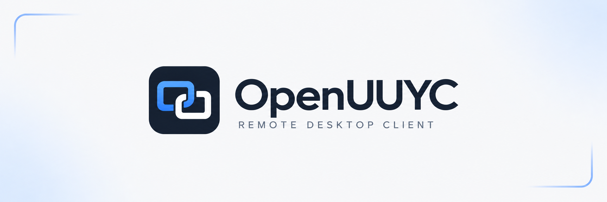

# OpenUUYC



OpenUUYC 是用 Rust 编写的 UU 远程第三方客户端，支持 Windows 和 Linux，支持主控、被控和远程协助。

后续计划支持 Linux 等其他平台，移植工作请先通过 [Issue](https://github.com/djkcyl/openuuyc/issues) 沟通。

## 下载与使用

从 [Releases](https://github.com/djkcyl/openuuyc/releases) 下载 Windows x64 客户端，扫码或短信登录后连接设备，支持 UU 官方客户端；无需登录也可在登录页开启“接受远程协助”。

最新稳定版为 [v1.0.1](https://github.com/djkcyl/farwing/releases/tag/v1.0.1)。

接收测试版更新提醒：在“关于”中开启“允许测试版”（默认关闭）。

**从 alpha.6 或更早版本升级需重新登录，设备 ID 会改变，旧设备条目需手动删除。**

## 能力表

以下对应 **v1.0.1** 在 **Windows x64** 上的能力，功能取决于双方能力与权限；Linux x64 需自行构建，差异见[下文](#linux-版差异)。

| 功能 | 主控端 | 被控端 | 说明 |
| --- | --- | --- | --- |
| 同账号远程连接 | 支持同时连接多台设备 | 支持 | 本机在连接设置中开启“允许被控” |
| 设备 ID / 验证码协助 | 支持主动连接 | 支持账号及游客协助 | 随机 / 自定义密码、本机确认；主控支持最近连接和收藏 |
| 画面传输 | 接收与播放 | 采集与编码 | H.264 / H.265 / AV1、真彩及 HDR，可调画质、码率和帧率；AV1 与 SDR 自动 10 位需双方 OpenUUYC 支持 |
| 编解码 | DXVA11 硬解 / Rust 软解 | NVENC、AMF、QSV 硬编 / Rust H.264 软编 | 可选格式与显卡首选；软解支持 H.264 / AV1，整个客户端最多一个软解播放窗口 |
| 键鼠与触摸 | 键盘、鼠标控制 | 键鼠及移动端原生触摸接收 | 相对/绝对鼠标、组合键、光标同步；可选 125 / 500 / 1000 Hz 鼠标节流（默认关闭） |
| 多显示器与显示设置 | 切屏、多窗口、本地比例拉伸、分辨率及 DPI 调整 | 多屏采集与设置接收 | 屏幕标签可拖出独立窗口；本地比例拉伸不修改远端分辨率，物理设置按目标支持的配置应用 |
| 虚拟屏、超级屏与无屏接管 | 支持操作远端 | 支持 | 需安装显示驱动；自动兜底屏断线保留，其他可用屏幕接入后回收 |
| 桌面声音 | 播放与远程音质调整 | 采集与发送 | 默认或指定设备，设备变化后恢复；64 / 128 / 192 / 256 kbps，远程调音质需双方 alpha.6+ |
| 仅音频连接 | 支持 | 支持 | 默认 256 kbps，提供波形、电平、网络 RTT、精简模式，可恢复画面 |
| 麦克风与虚拟声卡 | 选择麦克风、调整音质并发送 | 虚拟扬声器及远程麦克风接收 | 被控端需选装虚拟音频驱动，可配置默认音频设备切换策略 |
| 剪贴板与文件拖放 | 支持 | 支持 | 文字、富文本、图片及文件复制；OpenUUYC 双端支持双向拖放，与官方端连接时使用其支持的发送方式 |
| 独立文件传输 | 支持 | 支持官方 Windows / Android / iOS 收发 | 目录浏览、收发、文件管理及暂停续传；被控端需登录 Windows |
| 端口转发 | 支持 | 支持 | TCP 与官方互通；UDP 需两端 OpenUUYC，复用可靠通道；被控需开启许可 |
| 批注与指示工具 | 支持发送 | 支持接收 | 画笔、形状、撤销重做、白板、激光笔和鼠标指示；被控端需登录 Windows |
| 远程电源操作 | 开机、关机和重启 | 关机、重启、远程开机设置与局域网唤醒协助 | 提供有线网卡检查/配置；WoL 需 BIOS 开启及同网协助设备或已配置的 UU 路由器 |

被控通知可选程序浮窗或 Windows 通知，支持连接确认、断开及文件收发提醒。

向官方被控端拖入文件，需开启键鼠控制、剪贴板同步和文件复制。

另支持设备管理、自定义快捷键、本机诊断、性能监控、异常图标及[插件和节点图](plugins/README.md)。

全屏观看时，悬停顶部横条可展开操作栏并退出全屏，移开后自动收起；游戏鼠标锁定时需先释放键鼠控制。

支持本机导出及远端获取脱敏诊断包（ZIP / zstd，最多 32 MiB）；远端获取需双方 beta.3+，并开启被控端文件访问权限。

## 安装与服务

主页“安装服务”会将程序安装到 `Program Files\OpenUUYC`，安装后台服务、输入和显示驱动，创建快捷方式并配置托盘自启动。安装需管理员授权及驱动证书信任；关闭主窗口进入托盘，托盘“退出”结束运行。

“连接设置 → 启动 → 开机自启”控制登录 Windows 后是否在托盘启动：安装服务后指向已安装的程序，未安装时指向当前运行的程序。后续更新保留关闭状态；若 Windows 已禁用自启动，页面会提示并提供系统启动设置入口。关闭它不影响后台服务，已授权并允许被控的常驻服务仍可在开机后接入。

安装服务并开启被控后，支持锁屏、PIN 界面及重启后未登录 Windows 时接入。

更新时运行新版 EXE，点击“更新并打开”即可更新已有安装。虚拟声卡在“连接设置 → 服务管理”中选装；卸载可选择保留虚拟显示驱动、虚拟声卡及用户数据。

### 虚拟音频驱动的使用条件

**虚拟音频驱动使用测试签名，尚未取得 Microsoft 正式签名。** 使用虚拟扬声器或接收远程麦克风，需要手动准备测试启动环境；普通画面、键鼠和桌面声音不需要此设置。

- 临时测试：Shift + 重启 → 疑难解答 → 高级选项 → 启动设置 → 重启 → **7 / F7 禁用驱动程序强制签名**，仅本次启动有效。[Windows 说明](https://support.microsoft.com/en-us/windows/experience/startup-boot/windows-startup-settings)
- 持续测试：管理员执行 `bcdedit /set testsigning on` 后重启；恢复时执行 `bcdedit /set testsigning off` 并重启。Secure Boot、BitLocker 或组织策略可能限制操作。[微软说明](https://learn.microsoft.com/en-us/windows-hardware/drivers/install/the-testsigning-boot-configuration-option)

测试启动会降低驱动加载保护，程序不会自动修改这些设置。

## Linux 版差异

Linux 版可以登录、管理设备、观看和控制远端桌面，界面走 wgpu（Vulkan，缺失时回退 OpenGL），X11 与 Wayland 均可运行。本机被控在 Xorg 与 Wayland 会话中均可用（Wayland 下键鼠需要 `/dev/uinput` 权限，见下）。与 Windows 版相比：

- **解码**：H.264 通过 VA-API 硬件解码（Constrained Baseline、Main、High，8 位 4:2:0），其余 H.264 格式与 AV1 使用 Rust 软件解码；AV1 软解只声明 8 位 4:2:0（播放窗口按 NV12 绘制），10 位与 4:4:4 不向对端声明。H.265 暂不支持。双方都有硬件编解码时协商优先选硬件。硬件解码需要对应的 VA-API 驱动。编解码首选中的解码方式与编码方式（硬件优先、仅硬件、仅软件）可用，但不能指定显卡：VA-API 与 NVENC 都使用桌面所在的显卡，显卡一栏显示为“自动”。设 `OPENUUYC_ZEROCOPY=1` 时，VA-API 解出的画面以 dmabuf 直接交给渲染器、不经内存拷贝（零拷贝；只在 Intel 显卡上验证过，默认关闭）。
- **声音**：主控端的播放与麦克风经 PulseAudio 协议直接连接声音服务（PulseAudio 或 PipeWire 的 pulse 服务），输出设备列表即声音服务中的输出设备；没有声音服务时改用 ALSA。
- **剪贴板**：主控与被控两端都支持文字、图片与文件双向同步。粘贴远端复制的文件时，文件通过挂载在 `$XDG_RUNTIME_DIR` 下的只读 FUSE 文件系统按需读取，需要安装 `fuse3`。文件拖放在 Xorg 会话中可用，经 XDND 协议完成：作为主控，本地文件可拖进播放窗口（OpenUUYC 对端为实时拖放，官方被控为松手后投放），也可从 OpenUUYC 被控的桌面拖出到本地桌面，官方被控用队列浮窗发来的文件保存到下载目录；作为被控，主控拖入的文件在落点处投放给本机程序，向官方 Windows 主控发送文件时，在桌面上拖动文件会于屏幕顶部弹出待发送队列浮窗。远端文件以 FUSE 挂载的路径交给目标程序，读取时才按需传输；目标读完全部文件即视为完成，五分钟未读取则停止。Wayland 会话不支持文件拖放（提示“Wayland 桌面暂不支持拖放文件”）。拖出到本地或远端后不能再拖回原窗口接续原拖动（Windows 版经 OLE 支持），Linux 端不向对端声明这项能力，两端都把拖出视为结束；X11 拖放也没有拖动预览图。
- **拦截本机快捷键**：播放窗口的「拦截本机快捷键」与 Windows 版在同样的时机生效：窗口有键盘焦点、处于控制状态、没有打开菜单、弹窗或输入框，且远端接受键盘输入；释放控制、打开菜单或切到别的窗口即交还本机快捷键。Xorg 下以主动键盘抓取（`XGrabKeyboard`）实现，窗口管理器的 Alt+Tab、Super 等组合键会交给远端；抓取期间可用鼠标点别的窗口或按释放控制的快捷键交还。窗口管理器把输入焦点放在窗框而非播放窗口上时无法抓取，此时快捷键仍归本机（日志中有记录）。Wayland 下经 `zwp_keyboard_shortcuts_inhibit_v1` 请求合成器让出快捷键（GNOME、KDE、Sway、Hyprland、niri 等支持）：GNOME 第一次会弹窗询问是否允许；合成器保留自己的恢复快捷键（GNOME 为 Super+Esc），按下后快捷键回到本机，下次进入控制时重新申请。合成器不提供该协议时这项设置不起作用，快捷键仍归本机。在 Wayland 会话中以 XWayland 运行播放窗口时，键盘抓取只对 X11 程序有效，合成器自己的快捷键不受影响。
- **被控文件传输与电源**：独立文件传输在本机桌面用户身份下运行，路径为 Unix 路径，根目录列出 `/` 与 xdg 用户目录（文档、桌面、下载等），不允许经过符号链接。远程关机与重启经 systemd-logind 执行，受 polkit 策略约束（有其他用户登录时可能需要管理员授权）。远程开机的网络登记、局域网唤醒协助与网卡检查可用（检查只读：唤醒权限取自 sysfs，魔术包状态需安装 `ethtool`）；配置网卡需要 root，程序内不提供，请用 `sudo ethtool -s <网卡> wol g` 设置；开启远程开机时写入 `~/.config/autostart/openuuyc.desktop` 登录自启动。
- **本机被控**：在已登录的桌面内运行。画面采集按 Sunshine 的优先级选择：Xorg 下先用 NVIDIA NvFBC（画面直接抓进显存交给 NVENC，仅在 NVENC 可用时选用），再到 X11 MIT-SHM，最后是 XDG 屏幕共享门户（PipeWire）；Wayland 下只用门户。门户第一次使用时需要在本机屏幕上点“共享”，授权会被记住（`~/.local/share/OpenUUYC/screencast-restore-token`，在系统隐私设置中可撤销）；授权之前登录时不检测本机编码能力（以免登录卡在授权窗口），被控设置的编码列表在第一次被控连接后才按实际能力显示；可用环境变量 `OPENUUYC_CAPTURE`（如 `nvfbc`、`x11,portal`）指定顺序。编码优先用 NVENC（H.264/H.265，4:2:0 与 4:4:4，8 位；AV1 为 4:2:0 8 位，需要带 AV1 编码单元的显卡，尚未在这类显卡上实测），其次是 VA-API H.264 编码（AMD 与 Intel，8 位 4:2:0；只在 Intel Haswell 的 i965 驱动上实测；探测时会实际编码并解码一帧来确认驱动可用），都不可用时回退 Rust H.264 软件编码（没有 HDR 采集，因此没有 10 位）。门户采集另有两个默认关闭的试验开关：`OPENUUYC_CAPTURE_DMABUF=1` 向门户协商 DMA-BUF 缓冲，`OPENUUYC_GPU_CONVERT=1` 在 GPU 上把采集画面转成 NV12；桌面声音参照 Sunshine 经 PulseAudio 客户端接口录制所选播放设备的监听源（PulseAudio 与 PipeWire 均可）；该设备静音或音量为 0 时可能录不到声音；键鼠按物理键位映射注入：Xorg 会话经 XTest（指针绝对定位，无需设置）；Wayland 会话经 `/dev/uinput`（内核层，能到达原生 Wayland 客户端；需要写权限，deb 与 AUR 包带 udev 规则，见[安装](#linux)），没有权限时回退 XTest，只能控制 XWayland 程序。绝对定位参照 Sunshine 另建一台 uinput 绝对指针，由合成器按它经 `xdg-output` 报告的逻辑布局解算，分数缩放、旋转的屏上落点也准确（设备刚建好的约 1.5 秒内合成器可能还没接手，期间会补发位置）；合成器不提供 `xdg-output`，或有屏幕在其布局里找不到同名输出时，所有屏幕一起退回按当前指针位置换算的相对移动：Hyprland 下经其 IPC 读取指针与显示器布局，其他合成器只能从 XWayland 读取，指针停在原生窗口上时可能偏移。相对移动（含游戏模式）受系统指针加速影响，建议在被控端关闭加速。文字输入（移动端输入法等）在 Wayland 下经 `zwp_virtual_keyboard_v1`（Hyprland 等 wlroots 系合成器支持，GNOME 不支持时回退 XTest），Xorg 下经 XTest，都不依赖键盘布局；移动端触摸：Wayland 会话里本机被控会把触点交给一台虚拟多点触摸屏（与键鼠同一套 `/dev/uinput` 权限，不需要额外配置），双指滚动、捏合与手势都是真的，不再是把一个触点翻成鼠标左键；合成器布局读不到、主控看的不止一块屏、或者屏幕被转过时退回单指指针模拟（模拟走绝对指针，落点总是对的；合成器怎么把触摸屏认到哪块屏上各家不一样，猜错的代价是点错屏，所以这几件事先不猜）。Xorg 会话仍按单指指针模拟。支持物理多屏与通过 RandR 切换分辨率，退出时恢复。暂无 10 位与 HDR、KMS 采集、虚拟屏、超级屏、无显示器兜底屏、按显示器 DPI、被控设置中的「GPU 调度」（Windows 的进程 GPU 调度优先级，Linux 驱动没有对应接口，选项不显示）、远端麦克风与调整默认音频设备（OpenUUYC Audio 虚拟声卡是 Windows 驱动；Linux 上开启时会提示暂不支持），也没有后台服务，因此无法在登录界面或锁屏时被控。
- **息屏与休眠**：观看远端时，以及本机画面被采集期间，经 `org.freedesktop.ScreenSaver` 阻止自动息屏和空闲休眠（GNOME、KDE、Xfce、hypridle 等桌面支持），会话结束即释放。开始采集时会点亮已熄灭的显示器（GNOME 经 Mutter、KDE / Xfce 等经 `SimulateUserActivity`、X11 经 DPMS），不注入模拟输入；Hyprland 等只走 Wayland 且无上述接口的合成器无法点亮。桌面不提供抑制接口时只记录警告、照常连接，屏幕可能按空闲策略熄灭（Windows 版此时拒绝采集）。
- **访问通知**：「系统通知」走桌面的 freedesktop 通知服务（GNOME、KDE 等），允许、拒绝、查看按钮直接回到正在运行的程序；「程序浮窗」在 X11 下放在主显示器右下角，Wayland 下由合成器决定位置。
- **设备资料**：上报本机真实硬件，取自主机名、`/etc/os-release` 与内核版本、`/proc`、DMI 主板信息、PCI 显卡（按 `pci.ids` 命名）和默认路由所在网卡。SMBIOS 系统 UUID 只有 root 能读，因此系统标识由 `/etc/machine-id` 派生，重装系统后视为新设备。壁纸从 GNOME、Cinnamon、MATE 的 GSettings 或 KDE Plasma 配置读取，其他桌面会在诊断页提示暂不支持。
- **安装与托盘**：没有“安装服务”，直接运行构建出的程序。“开机自启”写入 `~/.config/autostart/openuuyc.desktop`，指向当前运行的程序（deb 安装为 `/usr/bin/OpenUUYC`），登录桌面后在托盘启动；在桌面的“启动应用程序”里停用它，开关也显示为关闭。关闭窗口收进托盘（StatusNotifierItem；GNOME 需 AppIndicator 扩展，Ubuntu 默认启用），托盘“退出”结束运行：Xorg 下窗口被隐藏；Wayland 不允许程序隐藏自己的窗口，关闭时销毁主窗口（后台连接、被控与通知照常运行），从托盘打开时按原尺寸重建，位置由合成器决定。启动时桌面没有托盘（没有 StatusNotifierWatcher，例如未启用 AppIndicator 扩展的 GNOME）则关闭即退出。程序已在运行时再次启动（如再点一次图标），新进程经 `$XDG_RUNTIME_DIR/openuuyc/control.sock` 让运行中的实例显示控制中心后退出（Wayland 下收进托盘的窗口随之重建；`--background` 启动不会唤起）；启动器给出的启动通知令牌（Wayland 的 `XDG_ACTIVATION_TOKEN`、X11 的 `DESKTOP_STARTUP_ID`）随请求转交，用来把窗口提到前台并结束启动反馈，合成器或窗口管理器仍可能按自己的防抢焦点策略只做提示。没有 `XDG_RUNTIME_DIR` 时没有这条通道，第二次启动只提示已在运行。SIGTERM（如 `systemctl --user stop`）与 SIGINT（终端里的 Ctrl+C）和托盘“退出”一样先完成后台收尾再退出；收尾被拒或卡住时，再发一次信号即按默认方式立即结束。
- **未接入**：批注与白板（主控发送和被控接收；被控收到批注请求会拒绝）、插件节点图、多显示器独立窗口、HDR、全局快捷键（快捷键仅在播放窗口获得焦点时生效），以及诊断页中的解码检查。
- **凭据**：登录态保存在系统密钥环（Secret Service），需要运行 gnome-keyring、KWallet 等服务；没有明文回退。

Wayland 下窗口的拖动与缩放由合成器接管，因此不支持窗口吸附等 Windows 专有行为。

## 构建

### Windows

需要 Rust stable（MSVC）、Visual Studio C++ 构建工具、Windows SDK、CMake 和 NASM，命令行工具需加入 PATH。H.264 软件编解码和 AV1 软件解码使用项目 Rust 核心及 SIMD 汇编。

```powershell
git clone https://github.com/djkcyl/openuuyc.git
cd openuuyc
cargo dist
```

产物为 `target/dist/` 下的单文件 EXE。仅构建原生 EXE 可用 `cargo dist --native`；命令行参数见 `--help`。

源码已包含签名驱动包和公钥证书，构建主程序不需要签名私钥。修改驱动及发布前验证见 [驱动构建说明](drivers/README.md)。

### Linux

需要 Rust stable（edition 2024）与 C/C++ 工具链。

#### Arch / Omarchy

[`packaging/aur/`](packaging/aur/README.md) 里有两份 AUR 配方：`openuuyc-bin` 安装 Release 里的压缩包，`openuuyc-git` 跟踪 `linux-port` 分支源码构建。它们还没有发布到 AUR，可以直接在本地构建：

```bash
cd packaging/aur/openuuyc-bin && makepkg -si
```

Omarchy 用户可以把 [`packaging/omarchy/omarchy-menu.jsonc`](packaging/omarchy/omarchy-menu.jsonc) 里的条目加进 `~/.config/omarchy/extensions/omarchy-menu.jsonc`，从 `Super + Space → Install → Service` 安装。不用 AUR 时，在源码目录构建后（或解压 Release 里的 `OpenUUYC-<版本>-x86_64-linux.tar.zst` 后）运行 `./install-omarchy.sh`，它会安装程序、桌面入口、uinput 规则和 Omarchy 菜单项（`--uninstall` 卸载）。

自建：

```bash
sudo pacman -S --needed base-devel cmake clang nasm pkg-config rust \
    libva libx11 libxcb libxrandr libxi libxcursor libxfixes \
    libxkbcommon libxkbcommon-x11 wayland libglvnd vulkan-icd-loader \
    dbus alsa-lib openssl fuse3 noto-fonts-cjk
cargo build --release --bin OpenUUYC
```

#### Debian / Ubuntu

Ubuntu 22.04 及以上：

```bash
sudo apt install build-essential cmake clang nasm pkg-config libva-dev \
    libasound2-dev libdbus-1-dev libxkbcommon-dev libxkbcommon-x11-dev \
    libwayland-dev libx11-dev libxcb1-dev libxrandr-dev libxi-dev libxcursor-dev \
    libgl1-mesa-dev libvulkan-dev libudev-dev libssl-dev fonts-noto-cjk fuse3
git clone https://github.com/djkcyl/openuuyc.git
cd openuuyc
cargo build --release
./target/release/OpenUUYC gui
```

#### 被控端输入权限（Wayland 必需）

Wayland 会话下键鼠经 `/dev/uinput` 注入。安装包会带上 udev 规则，重载后当前登录用户即可使用：

```bash
sudo udevadm control --reload-rules && sudo modprobe uinput
echo uinput | sudo tee /etc/modules-load.d/uinput.conf
```

规则使用 `TAG+="uaccess"`，由 systemd-logind 给本机活动会话授权，**不需要把用户加进 `input` 组，也不需要重新登录**。从源码构建或手动安装时，把
[`packaging/linux/60-openuuyc-uinput.rules`](packaging/linux/60-openuuyc-uinput.rules)
放到 `/etc/udev/rules.d/` 即可。没有权限时程序会记录一条警告并回退到 XTest（只影响 XWayland 客户端）。Xorg 会话不使用 uinput，无需这一步。

Wayland 下被控需要 XDG 屏幕共享门户：

```bash
# Hyprland
sudo pacman -S --needed xdg-desktop-portal-hyprland
# GNOME / KDE 使用对应的 xdg-desktop-portal-gnome / -kde
```

首次被控时会弹出一次共享授权，之后记在 `~/.local/share/OpenUUYC/screencast-restore-token`。

#### 硬件解码 / 编码

- **解码**：H.264 走 VA-API。AMD 用 `mesa`，Intel 用 `intel-media-driver`，NVIDIA 用 `libva-nvidia-driver`（Ubuntu 为 `nvidia-vaapi-driver`；并设 `NVD_BACKEND=direct`）；libva 2.15 以前认不出 NVIDIA 显卡对应的驱动，程序会自行指定，无需设置 `LIBVA_DRIVER_NAME`。
- **编码**（被控）：NVIDIA 用 NVENC；AMD 与 Intel 经 VA-API 编码 H.264（Intel 需 `intel-media-driver` 或 `libva-intel-driver`，AMD 用 `mesa`），都不可用时回退软件编码。
- **老 Intel GPU / 虚拟机**：Haswell/Broadwell 的 Vulkan 驱动未通过一致性认证，程序仍会使用它（设 `WGPU_ALLOW_UNDERLYING_NONCOMPLIANT_ADAPTER=0` 恢复 wgpu 默认的隐藏行为）；驱动无法向 Wayland surface 呈现时，可安装 `vulkan-swrast`（lavapipe）并用 `OPENUUYC_BACKEND=gl` 或 `OPENUUYC_BACKEND=vulkan` 指定界面后端。

`cargo dist` 只用于 Windows 打包，Linux 直接用 `cargo build`。

[`devtools/probes/`](devtools/probes/README.md) 里是验证 Linux 零拷贝与 GPU 颜色转换可行性的开发用探测程序（C 与一个独立的 Rust 小工程），不参与构建，用于在新驱动或新显卡上先确认 dmabuf 导出、Vulkan 导入和 VA-API 编码是否可用。

Arch / EndeavourOS 的构建依赖：

```bash
sudo pacman -S --needed base-devel rust nasm clang pkgconf libva alsa-lib dbus \
    libxkbcommon libxkbcommon-x11 wayland libx11 libxcb libxrandr libxi \
    libxcursor libglvnd vulkan-icd-loader openssl fuse3 noto-fonts-cjk
```

打包为 deb（GitHub Actions 的 “Linux deb” 工作流在 Ubuntu 22.04 上构建同样的包，产物见运行页面的 Artifacts，打 `v*` 标签时附到 Release）：

```bash
cargo install cargo-deb
cargo build --release --bin OpenUUYC
cargo deb --no-build
sudo apt install ./target/debian/openuuyc_*.deb
```

安装后从应用菜单启动，或运行 `OpenUUYC`。

## 命令行更新

从新下载的程序包运行 `OpenUUYC.exe update --silent`，静默更新已有安装。会中断当前连接，完成后不自动打开控制中心或重启 Windows；非管理员运行时仍需确认系统 UAC。

无人值守脚本使用 `update --silent --no-elevate`，由安装所属用户的管理员终端执行；权限不足返回 740，不弹 UAC。退出码：0 成功、3010 需重启、170 已有安装操作、1605 未安装、2404 驱动占用，其他失败为 1。不要同时保留其他更新窗口。

## 反馈与许可

问题和建议请提交到 [Issues](https://github.com/djkcyl/openuuyc/issues)。报告问题时附上双方版本、操作步骤、大致发生时间及导出的诊断包，分享前检查是否含私人信息。

OpenUUYC 非网易官方项目。源码公开，但项目整体未采用开源许可证，使用与分发条件见 [LICENSE](LICENSE)。第三方及派生代码保留各自的许可，详见 [THIRD_PARTY_NOTICES](THIRD_PARTY_NOTICES)。

## 鸣谢

感谢以下团队、项目和贡献者为 OpenUUYC 提供的参考、技术基础与开发支持：

- [网易 UU 远程](https://uuyc.163.com/)：本项目的协议兼容目标，也是远程连接功能与交互行为的参考。
- [SudoVDA](https://github.com/SudoMaker/SudoVDA) 与 [Microsoft Windows Driver Samples](https://github.com/microsoft/Windows-driver-samples)：虚拟显示驱动的源码基础，以及虚拟音频驱动的示例参考。
- [FFmpeg](https://ffmpeg.org/)：视频编解码基础算法及硬件解码适配的重要来源。
- [rav1d](https://github.com/memorysafety/rav1d) / dav1d：AV1 软件解码核心及 SIMD 实现。
- [Cisco OpenH264](licenses/openh264-algorithms.txt)：软件编码器的码率控制、屏幕变化检测与运动搜索等算法参考。
- [WebRTC](https://webrtc.googlesource.com/src/+/refs/branch-heads/5481/)、[WebRTC-rs](https://github.com/webrtc-rs/webrtc) 与 [goog_cc](https://github.com/kixelated/goog_cc)：实时传输、音频接收处理与拥塞控制基础。
- Opus / [SpeexDSP](src/media/audio/COPYING.SpeexDSP)：音频编解码与重采样算法。
- egui / [egui-directx11](https://github.com/NekomaruQwQ/egui-directx11)：图形界面与渲染基础。
- [OpenAI](https://openai.com/)：Codex 为本项目的开发提供 AI 编程辅助。
- [sisi0318](https://github.com/sisi0318)：提供两个 Codex x20 账号，支持本项目开发。
- ~~[Tibo（Thibault Sottiaux）](https://x.com/thsottiaux)：感谢他与 Codex 团队提供的额外额度重置。~~

也感谢[项目贡献者](https://github.com/djkcyl/openuuyc/graphs/contributors)及提供测试反馈和改进建议的用户。完整的第三方来源与许可说明见 [THIRD_PARTY_NOTICES](THIRD_PARTY_NOTICES)。
